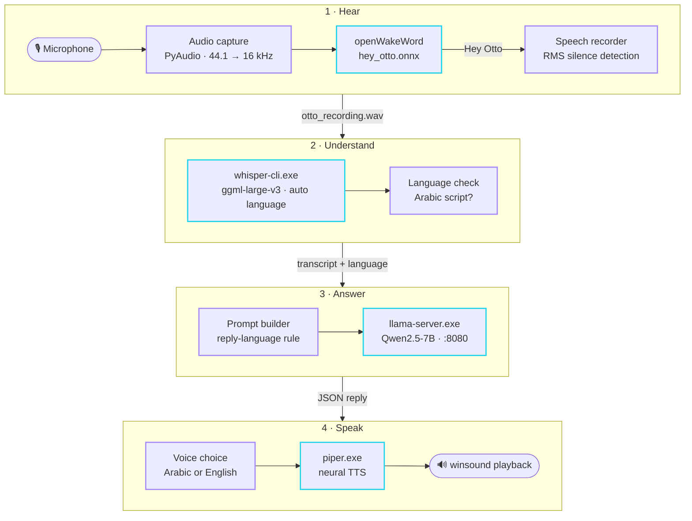
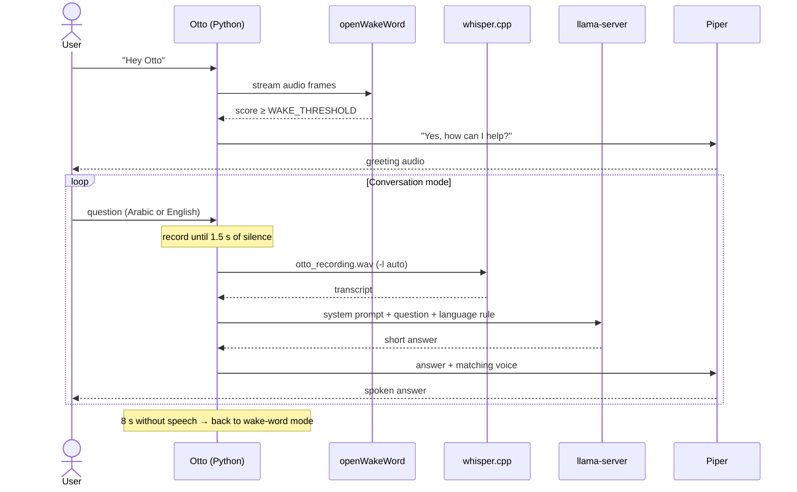
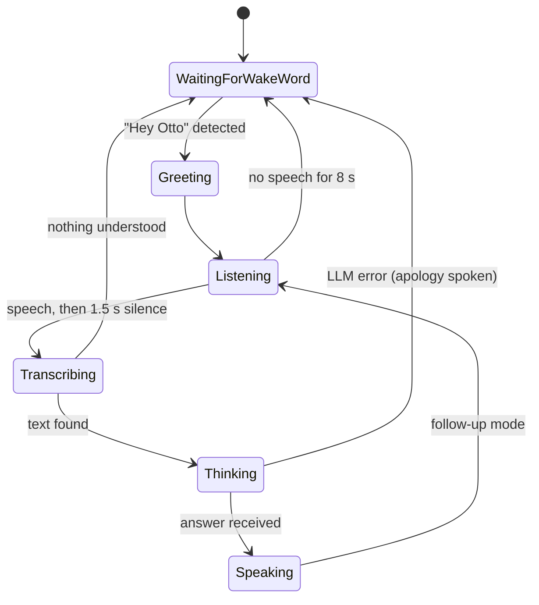

# Architecture

Otto is a single Python process (`otto_assistant.py`) that coordinates four local engines. Python handles audio capture, timing and routing; the heavy models run in their own optimized runtimes.



<sub>Cyan border = local AI engine · Violet border = Python logic in `otto_assistant.py`</sub>

## Components

| Component | Runs as | Input → Output | Why this choice |
| :-- | :-- | :-- | :-- |
| **openWakeWord** | Python library, in-process | 80 ms audio frames → wake-word score | Small, CPU-friendly, supports custom wake words |
| **whisper.cpp** (`whisper-cli.exe`) | Subprocess per question | WAV file → text | Strong Arabic + English accuracy with automatic language detection, no Python ML stack needed |
| **llama.cpp** (`llama-server.exe`) | Separate server process | Chat messages → reply | Runs quantized GGUF models fast on CPU or GPU behind an OpenAI-compatible API |
| **Qwen2.5-7B-Instruct** | Loaded by llama-server | — | Good multilingual model, including Arabic, at a size that fits consumer hardware |
| **Piper** (`piper.exe`) | Subprocess per reply | Text → WAV file | Fast neural TTS with offline Arabic and English voices |

Keeping the LLM in its own server means the 7B model is loaded **once** and stays in memory between questions, and Otto itself stays a lightweight script.

## Conversation flow



## States



## Audio pipeline

| Step | Detail |
| :-- | :-- |
| Capture | Mono, 16-bit PCM at the microphone's native rate (`MIC_NATIVE_RATE`, default 44.1 kHz) |
| Resampling | Every chunk is converted to 16 kHz with SciPy's polyphase `resample_poly`, the rate openWakeWord and Whisper expect |
| Wake-word frames | 1,280 samples (80 ms at 16 kHz) per prediction |
| Recording frames | 1,600 samples (100 ms) per chunk |
| Speech detection | Root-mean-square loudness of each chunk; `≥ 500` counts as speech |
| End of question | 1.5 s of continuous quiet after speech started (`SILENCE_DURATION`) |
| Idle timeout | No speech for 8 s (`CONVERSATION_IDLE_TIMEOUT`) returns Otto to wake-word mode |

## Language handling

Otto keeps Arabic and English consistent across the whole loop with one simple check: does the text contain characters from the Arabic Unicode block (`U+0600–U+06FF`)?

1. **Recognition** — Whisper runs with `-l auto`, so it detects the spoken language itself.
2. **Prompting** — if the transcript is Arabic, the system prompt and the user message both say *"Respond ONLY in Arabic."*; otherwise *"Respond ONLY in English. Do not use Arabic script."* Repeating the rule in the user turn makes smaller models follow it more reliably.
3. **Voice** — the reply text is checked again, and Piper uses the Arabic voice (`ar_JO-kareem-medium`) or the English voice (`en_US-amy-medium`) to match.

## LLM request

Otto sends a standard OpenAI-style chat request to `http://localhost:8080/v1/chat/completions`:

```json
{
  "messages": [
    { "role": "system", "content": "You are Otto, a friendly offline robot assistant. Respond ONLY in English. Do not use Arabic script. Keep answers short, clear, and helpful." },
    { "role": "user", "content": "What is the capital of Japan?\n\n(Respond ONLY in English. Do not use Arabic script.)" }
  ],
  "temperature": 0.3,
  "max_tokens": 100
}
```

- `temperature: 0.3` keeps answers focused and consistent.
- `max_tokens: 100` keeps replies short enough to speak naturally.
- Each question is sent on its own (no chat history), so every answer is independent.
- The request uses only Python's standard library (`urllib`), with a 60-second timeout.

Because the API is OpenAI-compatible, any model that llama-server can load works without code changes.

## Files written at runtime

| File | Written by | Purpose |
| :-- | :-- | :-- |
| `audio/otto_recording.wav` | Python | The user's latest question (16 kHz mono) |
| `audio/otto_response.wav` | Piper | Otto's latest spoken reply |

Both are overwritten on every turn and ignored by git.

## Privacy

- No network calls except to `localhost:8080`, the llama-server running on the same machine.
- No telemetry, accounts or API keys.
- Audio is kept only in the two temporary WAV files above, which are overwritten every turn.

## Known limitations

- **Windows only** — playback uses `winsound`, and the script calls `.exe` builds of whisper.cpp and Piper.
- **Fixed paths** — `PROJECT_DIR` and `MIC_DEVICE_INDEX` are set in the script, not in a config file.
- **Whisper reloads per question** — `whisper-cli.exe` loads the model each time, which adds latency with large-v3.
- **No memory between questions** — follow-ups don't see earlier turns.
- **Simple speech detection** — the fixed loudness threshold can struggle in noisy rooms.

## Ideas for future versions

- Keep Whisper loaded with whisper.cpp's server mode to cut transcription time.
- Send recent turns to the LLM so follow-up questions have context.
- Move settings into a `config.yaml` or `.env` file.
- Make Egyptian Arabic ([VoiceTut-TTS](https://huggingface.co/mohammedaly22/VoiceTut-TTS)) the default Arabic voice.
- Cross-platform playback (e.g. `sounddevice`) for Linux and macOS.
