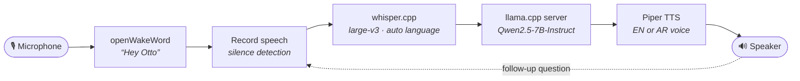

<h1 align="center">Otto — Offline Voice Assistant</h1>

<p align="center">
  A privacy-first voice assistant for Windows that listens, thinks and speaks in <b>Arabic and English</b> —<br />
  wake word, speech recognition, LLM and text-to-speech all running on your own machine.
</p>

<p align="center">
  
  
  
  
  
</p>

<p align="center">
  
</p>

---

## Why Otto?

Most voice assistants send your voice to a server. Otto doesn't. Every step — hearing the wake word, turning speech into text, generating an answer and speaking it back — runs locally, so it works without internet and nothing you say leaves your computer.

- **Custom wake word** — say *"Hey Otto"* to start a conversation (openWakeWord).
- **Bilingual speech recognition** — Whisper large-v3 auto-detects Arabic or English (whisper.cpp).
- **Local LLM** — Qwen2.5-7B-Instruct served by llama.cpp through an OpenAI-compatible API.
- **Replies in your language** — if you speak Arabic, Otto answers in Arabic; if you speak English, it answers in English.
- **Natural voices** — Piper neural TTS with separate English and Arabic voices.
- **Conversation mode** — after answering, Otto keeps listening for follow-up questions until you stay quiet for 8 seconds.
- **Zero telemetry** — no accounts, no API keys, no cloud calls.

## How it works



1. Otto listens to the microphone continuously and scores each 80 ms audio frame with a custom **"Hey Otto"** wake-word model.
2. Once triggered, it greets you and records until you stop talking (1.5 s of silence).
3. **whisper.cpp** transcribes the recording and detects the language automatically.
4. The text is sent to a local **llama.cpp** server, with an instruction to answer in the same language.
5. **Piper** speaks the answer with an Arabic or English voice, depending on the script of the reply.

The full design — components, timing, language routing and data flow — is in **[docs/ARCHITECTURE.md](docs/ARCHITECTURE.md)**.

## Tech stack

| Stage | Tool | Model used | Runs on |
| :-- | :-- | :-- | :-- |
| Wake word | [openWakeWord](https://github.com/dscripka/openWakeWord) | custom `hey_otto.onnx` | CPU |
| Speech-to-text | [whisper.cpp](https://github.com/ggml-org/whisper.cpp) | `ggml-large-v3.bin` | CPU or NVIDIA GPU |
| Language model | [llama.cpp](https://github.com/ggml-org/llama.cpp) (`llama-server`) | Qwen2.5-7B-Instruct (GGUF) | CPU or GPU |
| Text-to-speech | [Piper](https://github.com/rhasspy/piper) | `en_US-amy-medium`, `ar_JO-kareem-medium` | CPU |
| Audio I/O | PyAudio, SciPy, `winsound` | — | — |

## Quick start

> Full step-by-step setup, including downloading every model and running the LLM server, is in **[docs/INSTALLATION.md](docs/INSTALLATION.md)**.

```powershell
# 1. Get the code (the script expects this exact folder)
git clone https://github.com/Amr-Ebrahim/Otto-Assistant.git C:\otto-assistant
cd C:\otto-assistant

# 2. Install Python dependencies
python -m venv venv
venv\Scripts\activate
pip install -r requirements.txt

# 3. Download the models into C:\otto-assistant\models (see docs/INSTALLATION.md)

# 4. Start the local LLM server (in a separate terminal)
llama.cpp\llama-server.exe -m models\llm\qwen2.5-7b-instruct-q4_k_m.gguf --port 8080 -ngl 99

# 5. Run Otto
python otto_assistant.py
```

Then say **"Hey Otto"** and ask your question.

## Configuration

All settings live at the top of [`otto_assistant.py`](otto_assistant.py):

| Setting | Default | What it does |
| :-- | :-- | :-- |
| `PROJECT_DIR` | `C:\otto-assistant` | Root folder for `models/` and `audio/` |
| `MIC_DEVICE_INDEX` | `1` | Which microphone to use ([how to find yours](docs/INSTALLATION.md#7-choose-your-microphone)) |
| `MIC_NATIVE_RATE` | `44100` | Your microphone's sample rate; audio is resampled to 16 kHz |
| `WAKE_THRESHOLD` | `0.005` | Wake-word score needed to trigger |
| `SILENCE_DURATION` | `1.5` | Seconds of silence that end a question |
| `CONVERSATION_IDLE_TIMEOUT` | `8` | Seconds Otto waits for a follow-up before going back to sleep |
| `LLAMA_SERVER_URL` | `http://localhost:8080/v1/chat/completions` | Local LLM endpoint |

## Project structure

```text
otto-assistant/
├── otto_assistant.py      # Main loop: wake word → record → transcribe → LLM → speak
├── requirements.txt       # Python dependencies
├── docs/
│   ├── INSTALLATION.md    # Full setup guide (models, LLM server, microphone)
│   ├── ARCHITECTURE.md    # System design and data flow
│   └── assets/            # Diagrams
├── models/                # Model files — downloaded locally, not in git
│   ├── wake/              #   hey_otto.onnx
│   ├── whisper/           #   whisper-cli.exe (in Release/) + ggml-large-v3.bin
│   ├── llm/               #   Qwen2.5-7B-Instruct GGUF
│   └── tts/               #   piper/piper.exe + voice .onnx files
├── llama.cpp/             # llama-server binaries — not in git
└── audio/                 # Temporary recordings and replies — not in git
```

## Hardware

Otto runs on CPU, but a GPU makes it much faster. Rough model sizes on disk:

| Model | Size | Lighter alternative |
| :-- | :-- | :-- |
| Whisper large-v3 | 3.1 GB | `ggml-large-v3-turbo` (1.6 GB) or `ggml-large-v3-turbo-q5_0` (574 MB) |
| Qwen2.5-7B-Instruct Q4_K_M | 4.7 GB | Qwen2.5-3B-Instruct GGUF |
| Piper voices | ~60 MB each | — |

With an NVIDIA GPU, use the CUDA builds of whisper.cpp and llama.cpp. On a CPU-only machine, the lighter alternatives above keep response times reasonable.

## Egyptian Arabic voice (optional)

The script in this repository uses Piper's `ar_JO-kareem-medium` voice for Arabic. For a more natural **Egyptian Arabic** voice, I run [VoiceTut-TTS](https://huggingface.co/mohammedaly22/VoiceTut-TTS) locally on the GPU instead — an open-source model fine-tuned on Egyptian Arabic speech that also handles Arabic–English code-switching. Setup and the code change are in [docs/INSTALLATION.md](docs/INSTALLATION.md#9-optional-egyptian-arabic-voice-with-voicetut-tts).

## Acknowledgements

Otto is built on these open-source projects:
[openWakeWord](https://github.com/dscripka/openWakeWord) ·
[whisper.cpp](https://github.com/ggml-org/whisper.cpp) ·
[llama.cpp](https://github.com/ggml-org/llama.cpp) ·
[Piper](https://github.com/rhasspy/piper) ·
[Qwen2.5](https://huggingface.co/Qwen/Qwen2.5-7B-Instruct-GGUF) ·
[VoiceTut-TTS](https://github.com/MohammedAly22/VoiceTuT-TTS)

## License

Released under the [MIT License](LICENSE). Each model and tool above keeps its own license.
